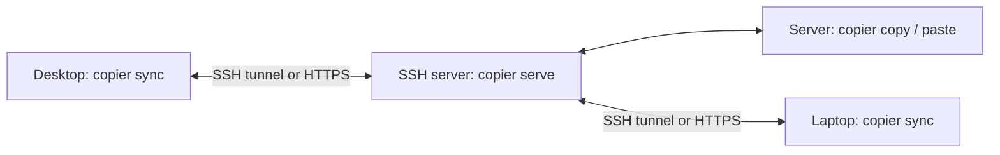

# Copier

A shared clipboard for Linux desktops, laptops and headless SSH sessions,
inspired by [pcopy](https://github.com/binwiederhier/pcopy). This is a new
implementation, with its own protocol; it does not connect to pcopy servers.

Copy files/folders from file managers, text, screenshots, images, HTML and application-specific clipboard
representations. Desktop copies retain all transferable formats together.
Use ordinary pipes, an interactive terminal menu, or an optional desktop
clipboard bridge. A central relay orders changes and refuses stale writes.

## Build

```sh
make build
./copier --help
install -m 755 copier ~/.local/bin/copier
```

Build requires Go 1.24+. Headless copy/paste/relay use just the binary. Desktop
integration additionally requires Python 3.9+, libwayland-client on Wayland,
and GTK3 runtime libraries for X11 or the XWayland fallback. The Python adapters
and protocol definitions are embedded in the binary; no pip packages are needed.

## Where the relay lives

The relay is the **same `copier` binary running `copier serve` on a machine you
choose**. It can run on your existing SSH server, a Linux VPS, or a reachable
always-on home server. No managed relay or cloud account was created by this
project; remote deployment is not configured yet.

For the desktop → server → laptop workflow, run one relay on the SSH server.
The desktop and laptop each connect to that relay. The server can also use its
own CLI against the relay, without a graphical desktop.



| Component | Runs where | Current default storage |
| --- | --- | --- |
| Relay process | Your chosen server | `~/.local/state/copier/relay.json` on that server |
| Relay access token | Server and authorized clients | `~/.config/copier/token` in the example setup |
| Client endpoint/token configuration | Each desktop/laptop/server CLI account | `~/.config/copier/config.json` |
| Pending operations | Each client | `~/.local/state/copier/pending/` and sync state files |
| Received files used for native pasting | Each receiving desktop | `~/.local/state/copier/received/`, or `--file-dir` |

`XDG_STATE_HOME` and `XDG_CONFIG_HOME` override those defaults. Relay `--data`
lets you choose another database location on persistent local storage. In the
current implementation, the relay stores clipboard manifests in its database
and requested content chunks beside it in `<relay.json>.chunks/`. The default
chunk cache quota is 20 GiB (`serve --cache-quota` changes it, in bytes).
Clients must be able to reach the chosen server through SSH, HTTPS or a VPN.
Hosting on a home machine does not automatically solve an unreachable home
network or NAT.

## Local copies and on-demand transfers

Native file clipboards hold file references, so copying a 3 GB file locally does
not put 3 GB into clipboard memory. Copier now announces a small file manifest
without reading or uploading the file contents. On the source device, pasting
uses the original paths. A different device gets read-only FUSE paths; looking
at file names and sizes transfers no file contents. Reading a file requests
verified 1 MiB chunks through the relay, with bounded lookahead and caching.
Applications may read files for previews or thumbnails before you press Paste;
those reads also trigger transfers.

Text, images and other native representations are captured into private source
storage and announced as offers. Their bytes are uploaded only when requested
by another device. `copier copy --local-only` creates a private native clipboard
without contacting the relay, and a running bridge respects its private marker.
Explicit `copy --from-clipboard` can publish it later.

File offers support up to 16 GiB total, 4096 entries and 64 directory levels.
The 32 MiB bound remains for captured clipboard representations, `--file` byte
copies and legacy ZIP packets; it is not the file-object transfer limit.
A sparse 3 GiB file is covered by the integration tests: native installation and
stat transfer no contents, and reading its tail transfers one 1 MiB chunk.

The source automatically starts a background `copier agent` to fulfill requests.
It must remain reachable, and original files must stay unchanged for uncached
reads. Offers expire after 24 hours. Source file identity and timestamps are
checked before and after chunk reads; detected changes fail instead of mixing
versions. File offers are deferred references, not immutable byte snapshots.
Metadata CAS revisions and idempotent request IDs still protect clipboard races.

Remote native file pasting requires `/dev/fuse` and `fusermount3`. Without FUSE,
use `copier paste --files DEST` to explicitly download to a new directory.
Source agents and remote FUSE mounts run as background processes, with private
PID/log files in the client state directory. `copier agent` can also run under
supervision. Do not copy `device.json` between devices: it identifies local
ownership. Client caches and source spools currently need manual cleanup after
consumers finish; relay chunk leases are cleaned up after expiry.

## Connect desktop → SSH server → laptop

Run one relay on a server reachable by all machines. Clients initiate outbound
connections; they do not need incoming ports or peer discovery. The following
uses SSH for authentication, encryption and crossing different networks.
Your SSH server must itself be reachable, directly or through a VPN/bastion.

On the server, generate a token and start the relay:

```sh
mkdir -p ~/.config/copier
chmod 700 ~/.config/copier
umask 077
copier token > ~/.config/copier/token
copier serve --token-file ~/.config/copier/token
```

In another server terminal, configure the server's CLI as a client:

```sh
copier join http://127.0.0.1:2587 --token-file ~/.config/copier/token
```

On **each desktop/laptop**, install the same binary, obtain the private token,
and keep a tunnel open:

```sh
mkdir -p ~/.config/copier
chmod 700 ~/.config/copier
scp server:~/.config/copier/token ~/.config/copier/token
chmod 600 ~/.config/copier/token
ssh -NT -o ExitOnForwardFailure=yes -o ServerAliveInterval=15 \
  -o ServerAliveCountMax=3 -L 127.0.0.1:2587:127.0.0.1:2587 server
```

In another local terminal:

```sh
copier join http://127.0.0.1:2587 --token-file ~/.config/copier/token
copier sync
```

Start sync on **both desktop and laptop**, then copy something normally on the
desktop. On the server over SSH:

```sh
copier paste                    # get desktop text in this shell
copier paste --type image/png > screenshot.png
printf 'hello from the server' | copier copy
```

After the next successful poll, paste normally on your laptop with Ctrl+V.
Paste-to-stdout emits bytes only; status messages go to stderr.

The first sync start establishes a baseline and leaves existing desktop content
alone. To explicitly publish an existing clipboard or fetch the current relay
clipboard, use:

```sh
copier copy --from-clipboard
copier paste --local
```

SSH's `-L` forwards the local port through the SSH connection to the relay
listening on the server's loopback address; `-N` keeps it as a tunnel without
running a remote command. [OpenSSH forwarding documentation](https://man.openbsd.org/ssh#L).

## Keep the server relay running

The foreground `copier serve` process stops when it is terminated. On a Linux
server using systemd, a user service can supervise it and restart failures.
The following assumes the token was created by the setup above and the binary
was installed at `~/.local/bin/copier`.
[systemd service documentation](https://raw.githubusercontent.com/systemd/systemd/main/man/systemd.service.xml).

Create `~/.config/systemd/user/copier-relay.service`:

```ini
[Unit]
Description=Copier personal clipboard relay

[Service]
Type=exec
ExecStart=%h/.local/bin/copier serve --listen 127.0.0.1:2587 --token-file %h/.config/copier/token --data %h/.local/state/copier/relay.json
Restart=on-failure
RestartSec=5
UMask=0077

[Install]
WantedBy=default.target
```

On the server, after stopping the foreground relay so the port/database lock
are available:

```sh
mkdir -p ~/.config/systemd/user
# Save the unit above to ~/.config/systemd/user/copier-relay.service first.
systemctl --user daemon-reload
systemctl --user enable --now copier-relay
systemctl --user status copier-relay
journalctl --user -u copier-relay -n 50
```

To keep this user's service manager running without an active login, a server
administrator can enable lingering for that account:

```sh
sudo loginctl enable-linger "$USER"
```

Lingering allows user services to run after logout and start at boot.
[systemd loginctl documentation](https://raw.githubusercontent.com/systemd/systemd/main/man/loginctl.xml).
Desktop `copier sync` runs separately inside each graphical session; running
the server relay does not itself connect to any desktop clipboard.

## HTTPS / VPN

To avoid SSH tunnels, expose the relay through HTTPS. The relay supports direct
TLS with `serve --listen :2587 --tls-cert cert.pem --tls-key key.pem`, or put a
TLS reverse proxy in front of its default loopback listener. Use normal trusted
certificates; the client validates certificates and does not follow redirects.

```sh
copier join https://clipboard.example.com --token-file ~/.config/copier/token
```

For a private VPN you may explicitly allow plain HTTP with `serve --allow-http`
and `--allow-http` on each client command, including `join`. That flag is not
saved as a permanent transport exemption. Compatibility wrappers require HTTPS
or loopback HTTP. Public unencrypted HTTP is rejected by default.

## CLI and interactive use

```sh
printf 'hello' | copier copy
copier copy --file screenshot.png          # image bytes, infer PNG MIME type
copier copy --files screenshot.png report.pdf folder/  # file objects
copier paste --files ./received            # extract into a NEW directory
copier copy --file payload.bin --type application/x-my-format
copier copy --from-clipboard               # native formats; announces file objects
copier paste --list-types
copier paste --type text/html > fragment.html
copier paste --local                       # restore all formats to desktop
copier history                            # revision metadata
copier paste --revision 7 > old-copy.txt
copier ui                                 # interactive menu, including restore
```

With no command, a terminal opens the menu; piped input is copied. Flags follow
the command. Run `copier COMMAND --help` for available flags. Configure using
`join`, or set `COPIER_URL`, `COPIER_TOKEN`, `COPIER_BOARD`, `COPIER_DEVICE`.
Separate boards support personal/work clipboards; use `--board work` or
`COPIER_BOARD=work`. Up to 32 boards are supported by one relay.

## Replace common xclip / wl-clipboard command forms

These opt-in shell aliases use Copier's relay:

```sh
alias xclip='copier xclip'
alias wl-copy='copier wl-copy'
alias wl-paste='copier wl-paste'

printf 'hello' | xclip -selection clipboard
xclip -selection clipboard -o
wl-copy --type image/png < screenshot.png
wl-paste --type image/png > screenshot.png
```

Supported wrappers cover input/output, selection, type, `wl-copy TEXT`,
`wl-paste --list-types`, and `wl-paste --no-newline`. Unsupported flags fail
explicitly. They are not complete behavioral emulations of the original tools.
On a desktop, a wrapper copy also claims the local clipboard after relay
success; on a headless server it copies only to the relay. Desktop selection
affects CLIPBOARD versus PRIMARY locally; both use the configured relay board.
Use separate boards if you want separate shared selections.

## Race, outage and retry behavior

- Every board has a monotonic revision; every relay database has an epoch.
  A copy must match both. Stale concurrent copies get a conflict, exit code 3,
  and retained local content. Explicit `copy --base REV` provides a revision
  precondition. A new/reset database cannot silently accept an old queued copy.
- CLI copies persist their operation before PUT. Transport failures retry the
  same ID up to three times with backoff and jitter. A lost response after a
  committed write returns its original revision rather than creating a duplicate.
- Failure/conflict messages identify a private pending JSON file. Use
  `copier retry --file PATH` to replay the same operation. Use `--force` only
  when you intentionally want its content to become a new latest copy.
- The desktop bridge preserves its pending write across disconnects and process
  restarts. It keeps retrying transient failures. On conflict it stops; restart
  with `copier sync --resolve local` to promote the pending copy, or
  `--resolve remote` to choose the relay copy. Remote resolution archives the
  pending local copy first and refuses to discard a newer desktop clipboard.
- One bridge may run per relay/board/backend/selection on each machine.
  File locks also prevent two relay processes writing the same database.
- Server snapshots are flushed and atomically replaced before success. Relay
  revision reads/writes are serialized. Keep the database on a local filesystem
  with working flock, atomic rename and fsync; this is a single-relay design.
- Retained history is limited to the latest 100 copies and 128 MiB per board,
  whichever is reached first. Idempotent receipts live within that history.
  An older evicted retry is rejected as stale, rather than reapplied. Native
  capture is bounded to 32 MiB and 128 formats; file offers use metadata limits.

The bridge polls at 500ms by default (`--interval 1s` changes this). It captures
all readable formats, detects owner changes during capture when the desktop
protocol supplies them, and rechecks local content after network I/O before
applying a remote clipboard. Echo suppression accounts for text aliases.

**Desktop ownership is not transactional.** Another application can copy in
the final check/write gap. Rapid intermediate copies between polls can be missed.
During an outage the bridge holds one durable pending operation; the current
desktop clipboard may contain a newer copy, which it samples after that pending
operation completes. It is not a recorder of every clipboard event. For work
requiring strict transfer identity, use explicit revisioned CLI operations and
history instead of automatic desktop sync.

CLI data cannot be queued if the initial head/epoch read itself fails; the
command reports failure and the caller should retain stdin/file input. The bridge
can queue after its baseline was established. It waits for a working relay to
establish its first baseline.

## Native clipboard portability

X11 uses GTK3 to own all targets together, preserving raw payloads, target names,
data types, and 8/16/32-bit units. Wayland uses ext-data-control or
wlr-data-control to own all MIME byte streams together without a focused window.
If the compositor lacks data-control, Copier uses its XWayland clipboard bridge
when `DISPLAY` is available. On a pure Wayland desktop without data-control it
reports that limitation; a compositor-specific clipboard integration is required.
Choose `--backend x11` or `--backend wayland` explicitly if needed.

Images such as PNG/JPEG, screenshot representations, HTML, plain text and opaque
application MIME byte streams can be transferred. Receiving applications choose
a format they understand. X11 protocol-management targets are excluded.
This preserves clipboard data, not the whole desktop's object model:

- File-manager copies are detected through `text/uri-list`, GNOME copied-file
  targets, or KDE URI lists. Referenced local files/folders become small offers.
  Remote receivers provide lazy native file URIs; local receivers use the
  original paths.
- Application-private formats may reference process handles, X11 atom IDs,
  shared memory, local objects or an application version. Preserving their bytes
  does not make those references meaningful on another computer.
- Wayland byte streams cannot preserve X11-specific numeric type semantics;
  common image/text/HTML formats use ordinary bytes and are portable.
- Compositor permissions and clipboard managers may rewrite or restrict formats.

The relay and local state store clipboard content in private files; transport
is encrypted through HTTPS or SSH. This is not end-to-end encryption against
the relay operator and there is no automatic secret detection. Enable desktop
sync only for the boards/devices on which you want clipboard sharing.

## File-manager copies and browser attachments

With `copier sync` running on sender and receiver, copy files/folders normally
in the sender's file manager, wait for synchronization, and paste in the
receiver's file manager or a web composer that accepts pasted file attachments.
For explicit operations:

```sh
copier copy --from-clipboard             # capture selected file objects
copier copy --files photo.png notes.pdf  # create file clipboard from CLI
copier paste --local                    # install lazy files in native clipboard
copier paste --files ./received          # headless extraction; destination must be new
copier ui                               # a: copy files/folders; e: extract; l: desktop paste
```

`--file PATH` copies a file's **bytes** as an image/text/opaque representation.
`--files PATH...` copies **file objects**, including their names and folder
structure. Put all flags before the paths. Named files are included as roots;
colliding basenames receive deterministic suffixes such as `report (2).pdf`.
Names with Unicode, spaces, `#` and percent signs are handled through escaped
native file URIs. Empty directories and owner-executable bits are preserved.
Other permissions are normalized to private owner permissions; timestamps,
ACLs, xattrs, symlinks, device files and sockets are not transferred.

Cut is transported as a copy: source files are never deleted. Plain text that
looks like a filename or `file://` URL is not treated as a file selection.
Non-local URI schemes/hosts are rejected instead of fetching remote resources.
URI lists containing only web links remain ordinary clipboard representations.
A file that changes or disappears before an uncached read causes failure.
Retry preserves the offer identity rather than snapshotting source bytes.

Explicit extraction streams into a private staging directory, validates paths
and chunks, then publishes it atomically without overwriting an existing
destination. Atomic extraction currently supports Linux amd64 and arm64.
Legacy ZIP packets retain their bounded validation and extraction support.

Remote desktop paths live under `$XDG_STATE_HOME/copier/received/` (normally
`~/.local/state/copier/received/`), or `--file-dir`. Their FUSE mount processes
must remain running while applications read them. Clipboard ownership changes
do not unmount them. Unmount and stop those processes before removing their
mount directories; remove cached data only after consumers have finished.

You can choose a directory your receiving browser/file manager can access:

```sh
copier paste --local --file-dir ~/Downloads/Copier
copier sync --file-dir ~/Downloads/Copier
```

The default cache may be outside a sandboxed browser's permitted filesystem.
Changing the location does not itself grant filesystem permissions. Native file
pasting works only where the browser exposes pasted files and the page handles
attachments; ordinary text boxes may ignore them. Folder pasting is supported
in file managers; browser folder attachments depend on the application and are
not guaranteed. The Copier TV channel includes a **Paste test** tab that reports
what files/formats your browser receives, without uploading anything.

New copies use `application/vnd.copier.offer+json` manifests. All machines
need this binary to resolve offers. Legacy ZIP packets remain readable.

## Verify

```sh
make check
COPIER_NATIVE_TEST=1 go test -race ./...
```

The second command tests real GTK/X11 transfers using a randomly named private
selection, leaving CLIPBOARD/PRIMARY alone. It requires an X11/XWayland display.
Protocol tests use a private fake compositor socket for both Wayland data-control
protocols and verify MIME offers and binary fd transfers in both directions.
Those tests do not certify every real Wayland compositor/application combination.

Additional tests cover concurrent CAS, retry after a lost response, durable
restart, authentication, format validation, database epochs, history eviction,
failed disk writes, locks, portable file/folder snapshots, native file URIs, unsafe
archives, edited cache preservation, concurrent extraction, desktop echo suppression, local changes during a
network fetch, and offline outbox recovery.

The bridge also adopts a matching CLI-updated desktop/relay head without echoing
that file copy or reporting a false stale-write conflict.

Protocol definitions retain their upstream licenses in `protocols/`. Native
adapter references: [GTK clipboard ownership](https://docs.gtk.org/gtk3/method.Clipboard.set_with_data.html),
[wlr data-control](https://github.com/swaywm/wlr-protocols/blob/master/unstable/wlr-data-control-unstable-v1.xml),
[ext data-control](https://gitlab.freedesktop.org/wayland/wayland-protocols/-/blob/main/staging/ext-data-control/ext-data-control-v1.xml).
